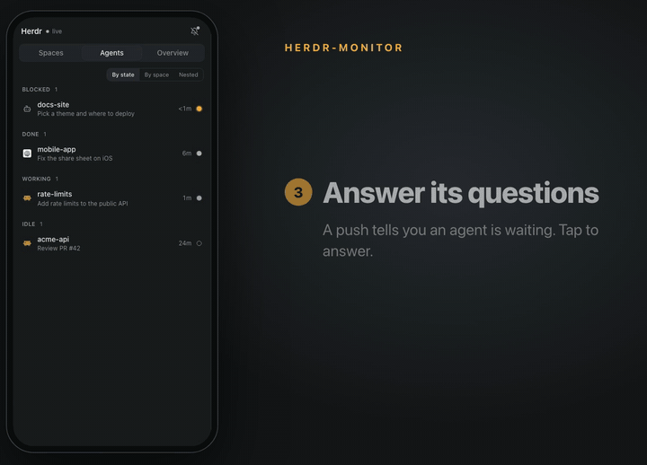

# herdr-monitor

A web app to watch and answer the coding agents that run in the
[Herdr](https://herdr.dev) app, made for a phone first. It talks to
herdr-core (`hc`) through its JSON-RPC socket. The server has no runtime
dependencies. The UI is Vite + React + TypeScript + Tailwind + shadcn/ui,
built to `dist/`.

- **Agents by state**: waiting, working and done, across every Herdr space.
  You can also group them by space, or nest them under the agent that
  started them.
- **Chat**: Claude Code, omp and pi conversations, rendered for a phone.
- **Answer questions**: tap the options of an agent's question form.
- **Reply**: type, paste or attach an image.
- **Push notifications** when an agent needs you (installed as a PWA).
- **Overview**: every open PR in your spaces, with checks and reviews.

## Run it

    npm install        # or: bun install
    npm start          # builds the UI, then starts the server
    npm run dev        # rebuilds the UI and restarts the server on change

Open <http://127.0.0.1:7400>. Node 20 or later is necessary.

| Variable            | Default                                                            |
| ------------------- | ------------------------------------------------------------------ |
| `PORT`              | `7400`                                                             |
| `HOST`              | `127.0.0.1`                                                        |
| `HC_SOCKET`         | `$HC_TERMINAL_SOCKET`, else `~/.local/state/herdr-core/default/default.sock` |
| `HERDR_APP_DIR`     | `~/.config/herdr-app` (space colours, agent store, icons; read only) |
| `HERDR_MONITOR_DIR` | `~/.config/herdr-monitor` (push keys and subscriptions, mode 600)  |
| `VAPID_SUBJECT`     | `mailto:herdr-monitor@localhost`                                   |
| `REDIRECT_PORT`     | `7480` (http → https helper for Tailscale Serve; `0` turns it off) |
| `HTTPS_PORT`        | `$PORT` (the https port the redirect points to)                    |

### On a phone

Use Tailscale Serve for https (Web Push and the service worker need it):

    tailscale serve --bg --https=7400 http://127.0.0.1:7400
    tailscale serve --bg --http=80 http://127.0.0.1:7480   # optional: http → https

Open `https://<machine>.<tailnet>.ts.net:7400`. With the second line,
`http://<machine>` and `http://<machine>.<tailnet>.ts.net` redirect there
(the server answers on 127.0.0.1:7480; `REDIRECT_PORT=0` turns it off).
`http://…:7400` cannot redirect: that port speaks only https.

To install: tap the bell. Chrome on Android and desktop gets an Install
button. On iPhone, follow the steps in the menu (Share → Add to Home Screen),
then open the app from the Home Screen. iOS sends Web Push only to a
home-screen app.

## Android app

A native Android app (Kotlin, Jetpack Compose) in [`android/`](android/). It
talks to this server over its HTTP API. It does not show the web UI in a
WebView.

- **Home**: an inbox of sessions (agents), in sections: **Needs you**
  (waiting at a question, or failed), **Working**, **Done**, **Ready to
  review**, and one collapsed **Idle** row. Filter chips above the list show
  the count of each section. A waiting card shows the question and up to three answer
  buttons. Each card shows the space colour, the status, the name, the task
  and the agent's last sentences. A session with no output for 30 minutes
  shows how long it has been quiet. **Ask Herdr** filters the list on the
  phone; it sends nothing. Long-press a card to pin it, stop it, open its
  terminal text or copy its branch. The bottom bar has **Sessions**, **PRs**
  and **Spaces**. The avatar at the top right shows the server and its link
  state.
- **New session**: the button on Home. Pick a space and a harness (Claude
  Code or omp) and type the task. The server starts the agent in that
  space's folder (`POST /api/sessions`) and the app opens it.
- **Spaces**: opening a space shows its agent sessions in Herdr order. Swipe
  left or right to move between them. App servers and raw shells are not
  swipe pages.
- **Agent**: Chat is the primary surface. PR, commits, status and running
  app-server pills sit above the reply box. **Session options** holds the
  raw terminal, sibling shells, stop, branch copy and share actions.
- **Fast start**: the app keeps the last sessions, PRs and last words it
  read from each server (in its cache folder, at most a day old). A cold
  start shows them at once, dimmed, with "Showing sessions from 9:31" until
  the live list is in. With nothing cached, Home shows placeholder cards.
  The last eight transcripts stay in memory, so an agent you opened before
  shows at once.
- **Offline replies**: a reply that you send with no link to the server goes
  into a queue on the phone. It shows in Chat as "queued". The app sends it
  when the link comes back, in order, per agent. You can delete a queued
  reply before it goes.
- **Look**: Material 3 Expressive, dark by default. Settings has Dark, Light
  or System, and an option for wallpaper colours.
- **Brand**: a border collie (the orchestrator) and sheep (the agents). The
  launcher icon is an adaptive icon with a monochrome layer (themed icons).
  The splash shows the collie on wheat, or on pine in dark mode. The
  notification and tile icons are the white collie head. Sessions and Spaces
  have sheep and paddock glyphs, and empty and offline Home show a scene.
- **Notifications**, on three channels, grouped by server:
  - **Needs you** (high): an agent asks a question or stopped with an
    error. Up to three answer buttons, or Reply.
  - **Running** (low, silent): for a pinned session while it works (at most
    three; pin a session from its long-press menu), with its current step
    and a **Stop** button. A four-stage bar (Plan, Edit, Verify, PR); the
    app guesses the stage from the agent's tool calls, because the server
    does not report one.
  - **Finished**: the result line, **Open PR** (when the space has one),
    **View session** and Reply.
  An alert goes away when the agent moves on, for example when you answer
  it on the Mac. An answer from a notification shows as "Sent" on the Home
  card.
- **Quick settings tiles**: **Herdr** shows "2 need you" (or "4 working");
  a tap opens Sessions filtered to Needs you. **Quiet agents**: when on,
  only the Needs you channel alerts.
- **Widget** (4x2): the server name, three counts (Needs you, Working,
  PRs) and the top Needs you session with its first answer button. It
  changes when the server sends a change, not on a timer.
- **Settings**: the server URL, **Find on tailnet** (lists the herdr-monitor
  servers on your tailnet, with each one's Herdr app, Herdr TUI and hc
  versions), the background-alerts switch, Quiet agents and the look.

The phone must be on Tailscale, on the same tailnet as the Mac. No Google
account, Firebase or push service is used: while alerts are on, the app keeps
one link to the server (`GET /api/agents/stream`) and shows a quiet "Herdr
monitor connected" notification.

### Build and install

The app needs Android 12 or later. To build it, you need the Android SDK
(`ANDROID_HOME`) and JDK 21 or later (the screenshot tests need 21; the app's
bytecode is Java 17). Android Studio is not needed.

    cd android
    ./gradlew assembleDebug         # app/build/outputs/apk/debug/app-debug.apk
    ./gradlew test lint             # unit tests, screenshot tests and lint
    ./gradlew verifyPaparazziDebug  # compare the screenshots with the records
    ./gradlew recordPaparazziDebug  # after a deliberate UI change: new records
    ./gradlew connectedDebugAndroidTest   # UI tests (an emulator or a phone)
    ./gradlew installPerf           # release code (R8), debug key: to measure speed

Install it with a USB cable (USB debugging on):

    adb install -r app/build/outputs/apk/debug/app-debug.apk

Or send the APK to the phone (for example with Google Drive or a chat app),
open it, and allow the install. The debug build is signed with the debug
key. The release build is shrunk with R8 (about 4 MB instead of 60 MB for
debug). A debug build draws several times slower, so measure start-up and
frames on the `perf` build.

### Release signing

The release build is for sideloading only (not Google Play). Its key stays on
your Mac, outside the repo: `~/.config/herdr-monitor/android-release.jks`.
Never commit a keystore or its password (`*.jks`, `*.keystore` and
`keystore.properties` are in `android/.gitignore`).

1. Make the keystore once. `keytool` asks for a password; keep it in your
   password manager. If you lose the key, phones that have the app must
   uninstall it before they can install a build signed with a new key.

       mkdir -p ~/.config/herdr-monitor
       keytool -genkeypair -keystore ~/.config/herdr-monitor/android-release.jks \
         -alias herdr -keyalg RSA -keysize 4096 -validity 10000 -dname "CN=Herdr Monitor"
       chmod 600 ~/.config/herdr-monitor/android-release.jks

2. Give Gradle the password, in `~/.gradle/gradle.properties` (not the repo's
   file) or as an environment variable of the same name:

       HERDR_RELEASE_STORE_PASSWORD=...

3. Build and install:

       ./gradlew assembleRelease   # app/build/outputs/apk/release/app-release.apk
       adb install -r app/build/outputs/apk/release/app-release.apk

| Setting | Default |
| --- | --- |
| `HERDR_RELEASE_STORE_FILE` | `~/.config/herdr-monitor/android-release.jks` |
| `HERDR_RELEASE_STORE_PASSWORD` | none: without it the release APK is unsigned (`app-release-unsigned.apk`) |
| `HERDR_RELEASE_KEY_ALIAS` | `herdr` |
| `HERDR_RELEASE_KEY_PASSWORD` | the store password |

A phone that has the debug build must uninstall it before it installs the
release build, because the two builds are signed with different keys.

### Set it up

1. Open the app and allow notifications.
2. In Settings (the gear), type the server URL, for example
   `https://<machine>.<tailnet>.ts.net:7400`, or tap **Find on tailnet** and
   pick a server. The app finds servers through a server it can reach,
   because an Android app cannot read Tailscale's list of machines.
3. For alerts on time when the phone sleeps, tap **Run unrestricted**.

### Notification actions

Android shows at most three buttons on a notification.

| Agent | Buttons |
| --- | --- |
| Waits at one single-choice question | Its first three options (then Reply). A tap answers the question, like a tap in Chat (`POST /api/terminals/:t/answer`). |
| Waits at another dialog | **Reply** (types into the dialog with `force`), **Interrupt** (`POST …/interrupt`), **Open** |
| Error | **Reply** (`POST …/send`), **View session** |
| Done | **Open PR** (when there is one), **View session**, **Reply** |
| Working | **Stop** (`POST …/interrupt`) |

A tap on the notification opens that agent in the app. Every button that
types or presses keys asks you to unlock the phone first. The app sends an
`Origin` header equal to the server URL, so the server's same-origin check
applies to it unchanged.

## What it shows

- **Agents.** Grouped like Herdr's sidebar: Blocked, Error, Done, Working,
  Idle, with the time since the last change. Sub-agents sit under their
  parent. "Done" turns into Idle once you open the agent here or in Herdr.
- **Spaces.** Herdr's spaces in Herdr's order, with their colour, branch
  (when it is not the default branch) and `↓N` when behind the upstream.
  Worktrees sit under their main repo.
- **Overview.** How many agents wait for you, work, or finished unseen, and
  the open PRs of the spaces' repos. Tap a number to see the list.
- **Agent.** One header with the Output | Commits | Status switch.
  - Output: the agent's screen. It refreshes while the agent works. "Load
    history" reads the scrollback (about 2 seconds: `hc` scrolls the agent).
  - Commits: the PR for the agent's branch (`gh pr view`), or the commits
    since the default branch. Tap a commit for its message and files.
  - Status: whether the PR can merge and why not, reviews and checks.
  - Reply box: on a phone, Enter adds a line and the arrow sends. On a
    desktop, Enter sends. The square button presses the agent's stop key.
- **Notifications.** The bell turns on Web Push for this device. You get
  one when an agent becomes blocked, done or fails (at most one per agent
  and state in 30 s). A tap opens the agent.
- **Deep links.** `#t2s/commits`, `#space/<id>`, `#list/waiting`.

Program icons come from your Herdr install (`~/.config/herdr-app/icons`),
not from this repo.

## Safety

- The server listens on 127.0.0.1 only. There is no login. For access from
  a phone, use Tailscale Serve (your tailnet only). Do not expose the port
  to the internet: do not use Tailscale Funnel.
- A POST must come from the page's own origin. Other websites cannot send
  text to your agents.
- The page can answer dialogs. In the Chat view, a tap on an option of an
  omp or pi question form calls `POST /api/terminals/:t/answer`. The server
  reads the screen to find the question the form shows, then presses only
  navigation keys (arrows, Space, Enter; no Ctrl or Alt). If the form is not
  on screen, it presses nothing. While an agent is blocked, Send types into
  the dialog with `force`. Otherwise `terminal.send` is called
  without `force`, so hc refuses to type into an agent that just became
  blocked.
- `POST /api/sessions` (New session) starts only `claude` or `omp`, in the
  folder of a space that already exists. The client sends a space id, a
  harness name and the task text. It cannot send a path or a command. The
  task text goes to the agent as one argument, with no shell.

## How it works

    browser ── SSE /api/events ──┐
            ── fetch /api/... ───┤  server.js ── 2 sockets ── hc (herdr-core)
                                 │   events.subscribe  (status, title, doc)
                                 │   doc.get herdr-app (spaces and tabs)
                                 │   terminal.get/read/send/interrupt
                                 ├─ lib/sidebar.js ── git (repo, worktree, branch)
                                 ├─ lib/git.js, lib/pr.js ── git, gh
                                 └─ lib/push.js ── Web Push (VAPID, aes128gcm)

    web/ (React) ── vite build ──> dist/ (served by server.js)

    Android app ── SSE /api/events (screens), /api/agents/stream (alerts)
                ── /api/info, /api/discover ── lib/herdr.js, lib/agents.js

`hc schema` prints the full `hc` API.

## Test

    npm test           # server and library tests (node:test)
    npm run typecheck  # the UI
    cd android && ./gradlew test lint   # the Android app

## License

MIT. See [LICENSE](LICENSE).
